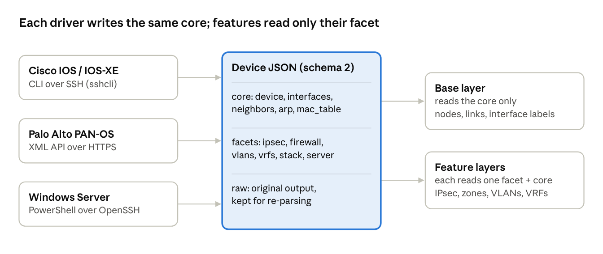

# Multi-vendor device data design

Created 2026-10-25 · Status: proposed (decisions resolved in the [2026-10-26 revision](../2026-10-26/multi-vendor-device-data-design.md))

## Summary

I recommend one JSON file per device, built from three parts. A shared **core** holds the layer 1 to 3 data that every device has. Optional **facets** hold the data that depends on what the device does. A **raw** section keeps what was actually collected.

- **Core.** Every device fills in identity, interfaces, MAC and IP addresses, neighbors and ARP entries in the same shape, whatever its vendor. The base layer of the diagram reads only the core, so it works the same for a router, a firewall or a server.
- **Facets.** Function-specific data goes in named facets, such as `ipsec`, `firewall`, `vlans`, `stack` or `server`. Each is owned by one feature. A device that lacks a facet is simply left off that feature's layer.
- **Raw.** The collector's original output, kept for debugging and so parsers can be re-run later without contacting the device again.

This gives you one format to work with, without forcing a Windows server and a Palo Alto into the same fields. Palo Alto can be collected with its XML API, and Windows with PowerShell over OpenSSH. Both work with the standard Python library only.

## Current JSON format

Today there are two shapes. One is written to disk, and the other exists only in memory while the diagram is built.

**On disk** (`output/facts/<name>.json`), written by `collect.py`. It's just the raw text of each command:

```json
{
  "inventory_name": "AT-8K-1",
  "platform": "ios",
  "cli": {
    "show version": "Cisco IOS XE Software, Version 17.18.02 ...",
    "show interfaces": "GigabitEthernet1 is up, line protocol is up ...",
    "show ip interface": "GigabitEthernet1 is up ... Internet address is 10.0.12.1/30 ...",
    "show crypto session detail": "Interface: Tunnel10 ..."
  }
}
```

**In memory**, after `netparse` reads the text. These field names are inherited from NAPALM:

```json
{
  "inventory_name": "AT-8K-1",
  "hostname": "AT-8K-1",
  "interfaces": {
    "GigabitEthernet1": {"is_up": true, "is_enabled": true, "description": "to AT-8K-2",
                         "speed": 1000.0, "mtu": 1500, "mac_address": "52:54:00:12:34:56"}
  },
  "interfaces_ip": {
    "GigabitEthernet1": {"ipv4": {"10.0.12.1": {"prefix_length": 30}}}
  },
  "cli": {"...": "kept, so features can parse their own commands"}
}
```

What this shape can't express:

- There's no device role, vendor, model or OS version. Every node looks the same to the renderer.
- There's no VRF on an interface. Two VRFs that reuse 10.0.0.0/30 would be drawn as a false link.
- There are no VLANs, LAG members, neighbors (LLDP/CDP) or ARP and MAC tables. Without those, a server on a switch access port can't be connected to anything.
- Features parse vendor CLI text themselves (IPsec reads Cisco output directly), so every feature would need a parser for every vendor.
- Nothing on disk is parsed, so the format has no version and other tools can't use it.

## Proposed format: core plus facets

Every device gets one file with a fixed core that all vendors fill in the same way, and optional facets for whatever its role adds. A shortened Palo Alto example:

```json
{
  "schema": 2,
  "device": {
    "name": "pa-fw1", "role": "firewall", "vendor": "paloalto", "platform": "panos",
    "model": "PA-3220", "os_version": "11.1.4", "serial": "0123456789",
    "collected_at": "2026-10-25T01:00:00Z", "collector": "panos-api"
  },
  "interfaces": [
    {"name": "ethernet1/1", "kind": "physical", "mac": "00:1b:17:00:01:10",
     "admin_up": true, "oper_up": true, "speed_mbps": 1000, "mtu": 1500,
     "description": "to core-rtr1", "vrf": "default", "vlan": null, "parent": null,
     "ipv4": ["203.0.113.2/30"], "ipv6": []}
  ],
  "neighbors": [
    {"local_intf": "ethernet1/1", "protocol": "lldp", "remote_name": "core-rtr1",
     "remote_intf": "Gi1", "remote_mac": "52:54:00:12:34:56"}
  ],
  "arp": [{"ip": "203.0.113.1", "mac": "52:54:00:12:34:56", "intf": "ethernet1/1", "vrf": "default"}],
  "mac_table": [],
  "facets": {
    "firewall": {"zones": [{"name": "untrust", "interfaces": ["ethernet1/1"]}], "virtual_systems": ["vsys1"]},
    "ipsec":    {"tunnels": [{"interface": "tunnel.10", "local_address": "203.0.113.2",
                              "peer_address": "198.51.100.7", "status": "UP"}]}
  },
  "raw": {"show interface all": "<response>...</response>"}
}
```

**The core** is what the base layer draws from. These are the layer 1 to 3 facts you can count on from every device:

| Field | Contents | Who fills it |
| --- | --- | --- |
| `device` | Name, role, vendor, platform, model, OS version, serial, when and how it was collected | Every driver. `role` picks the default icon and shape. |
| `interfaces` | Name, kind (physical, LAG, VLAN, loopback, tunnel, virtual), MAC, up/down, speed, MTU, description, VRF, VLAN, parent (LAG or stack member), IPv4 and IPv6 | Every driver |
| `neighbors` | LLDP or CDP entries: local port, remote name, port and MAC | Devices that run LLDP or CDP. Optional. |
| `arp`, `mac_table` | IP-to-MAC and MAC-to-port tables | Routers, firewalls and switches. Optional. |

Interfaces become a list with flat fields, replacing NAPALM's nested dictionaries. VRF on the interface lets subnets be grouped per VRF.

**Facets** hold everything that depends on the device's job. Each facet has one owner, the feature that draws it, and one documented shape, whatever vendor produced it:

| Facet | Typical devices | Drawn by |
| --- | --- | --- |
| `ipsec` | Routers, firewalls | IPsec tunnels layer (exists today) |
| `firewall` | Palo Alto | Zones layer: zones as shaded groups around their interfaces |
| `vlans` | Switches, firewalls, servers with tagged NICs | VLANs layer |
| `vrfs` | Routers, firewalls (virtual routers) | VRFs layer: one colour per VRF |
| `stack` | Switch stacks | Stack members drawn inside one node |
| `routing` | Routers, firewalls | BGP/OSPF peering layer |
| `server` | Windows servers | Roles and services (AD, DNS, DHCP, IIS) in the node tooltip, plus a services layer |

The rules that keep this workable:

1. The base layer reads only the core. Features read only their own facet plus the core.
2. A device without a facet is fine. That feature just draws nothing for it.
3. A facet's shape is vendor-neutral. The Cisco and Palo Alto drivers both produce the same `ipsec` facet, so the IPsec feature no longer parses vendor CLI itself.
4. `schema` is a version number. A change that breaks the shape bumps it, and the loader upgrades older files.
5. Raw output is always kept, so a parser fix can be applied to old data by re-parsing it, without logging in again.

## Link inference across device types

Shared subnets alone won't connect most new devices, so links should be built from several kinds of evidence, most trusted first. Today's rule works for routers on /30 links. A server sits on a /24 with dozens of other hosts, and a layer-2 switch port has no IP address at all.

| Evidence | What it proves | Example |
| --- | --- | --- |
| 1. LLDP or CDP neighbor | The exact cable: this port to that port | Switch Gi1/0/5 to firewall ethernet1/1 |
| 2. MAC table entry | A device's MAC was learned on a switch port, so it hangs off that port | Server NIC MAC seen on switch Gi1/0/12 |
| 3. ARP entry | Layer-3 adjacency to a router or firewall, with no specific port | Firewall ARPs the server's address |
| 4. Shared /30 or /31 | A point-to-point link between two devices | Today's rule |
| 5. Shared larger subnet | Several devices on one segment | Drawn as a segment node, not a mesh |

Changes this needs:

- **Subnets are grouped by VRF and network together**, so a /30 reused in two VRFs doesn't create a false link.
- **A subnet with three or more members becomes a small segment node** (for example "VLAN 20 · 10.20.0.0/24") with each device linked to it. That replaces today's full mesh, which grows as the square of the number of members.
- **MAC tables place servers.** A Windows server's NIC MAC found in a switch's MAC table links the server to that exact switch port. This is how servers get onto the diagram without LLDP. The match should ignore MACs learned on uplinks (ports whose neighbor is another switch), or every server ends up attached to the core.
- **Each link records its evidence** (`lldp`, `mac`, `subnet`) for the tooltip. A layer setting could hide inferred links.
- **LAGs and stacks:** members of a port-channel collapse into one link with a member count, and a stack's member switches collapse into one node.

## Collecting from Palo Alto

Use the PAN-OS XML API over HTTPS rather than SSH. It returns structured XML, so nothing has to scrape CLI text, and Python's standard library has everything it needs (`urllib`, `ssl`, `xml.etree`).

How the collector would work:

1. Get an API key once per run with `type=keygen`, using the same Network credential as the Cisco devices. Alternatively, a stored API key in its own AWX credential avoids sending the password.
2. Run operational commands (`type=op`), each returning XML:

| Command | Gives | Goes to |
| --- | --- | --- |
| `show system info` | Hostname, model, serial, PAN-OS version | `device` |
| `show interface all` | Interfaces with MAC, state, speed, IP, zone, virtual router, VLAN tag | `interfaces` (virtual router becomes `vrf`) |
| `show arp all` | ARP table | `arp` |
| `show lldp neighbors all` | LLDP neighbors, if LLDP is enabled | `neighbors` |
| `show vpn ipsec-sa`, `show vpn ike-sa` | IPsec and IKE tunnels with peers and state | `ipsec` facet |
| Zone and virtual system config (`type=config&action=show`) | Zones and their interfaces | `firewall` facet |

3. Write the normalized file, plus the raw XML under `raw`.

Things to settle:

- **Certificates.** Firewall management interfaces often use a self-signed certificate. The collector should take a CA bundle path, with turning off verification as an explicit per-host opt-in, never the default.
- **Panorama.** With many firewalls, Panorama can proxy API calls to each managed firewall (by serial number). That means one credential and one address. It's worth considering if the production firewalls are managed through it.
- **HA pairs** report the peer's state, so an active/passive pair can be drawn as one node with a badge, or as two nodes with an HA link.

## Collecting from Windows servers

I recommend running PowerShell over OpenSSH and having it return JSON. OpenSSH Server ships with Windows Server 2019 and later as an optional feature, and our collector already drives the system `ssh` client. PowerShell's `ConvertTo-Json` returns structured data, so there's no text to parse.

The options:

| Option | Fits the no-dependency rule? | Notes |
| --- | --- | --- |
| **PowerShell over OpenSSH** (recommended) | Yes | Needs OpenSSH Server enabled on each server, which can be pushed by Group Policy. Server 2016 needs it installed separately. |
| WinRM through Ansible's Windows modules | No | Needs `pywinrm` from pip plus the `ansible.windows` collection, which is what we just removed. |
| WinRM written from scratch | Technically, but painful | Domain servers expect NTLM or Kerberos. NTLM needs MD4, which recent OpenSSL builds of Python no longer provide. |
| Servers push their own JSON (scheduled task to a share) | Yes | No inbound access needed, but it's another moving part to deploy and keep current. |

What the collector would run, as one PowerShell script:

| Cmdlet | Gives | Goes to |
| --- | --- | --- |
| `Get-CimInstance Win32_ComputerSystem`, `Win32_OperatingSystem` | Name, domain, model, OS version, serial | `device` (role `server`) |
| `Get-NetAdapter` | NICs with MAC, status, speed, VLAN ID | `interfaces` |
| `Get-NetIPAddress` | IPv4 and IPv6 addresses with prefix length | `interfaces` |
| `Get-NetNeighbor` | ARP and neighbor cache | `arp` |
| `Get-NetLbfoTeam` or `Get-VMSwitchTeam` | NIC teams and their members | `interfaces` (`kind: lag`, `parent`) |
| `Get-WindowsFeature` (installed only) | Roles such as AD DS, DNS, DHCP, IIS, Hyper-V | `server` facet |

Windows doesn't normally run LLDP, so servers are placed on the diagram by matching their NIC MAC addresses against switch MAC tables (see link inference). That makes collecting `show mac address-table` from the switches a prerequisite for servers to show up connected.

Credentials would come from an AWX Machine credential (domain service account), injected as environment variables in the same way the Network credential is now.

## Code structure: platform drivers and features

Vendor knowledge lives in exactly one place, a platform driver, and features never see vendor output. That's what lets device types and features be added independently.



A **platform driver** is one module per platform under `scripts/drivers/`, replacing today's `netparse/`. Each driver declares:

- `transport`: `ssh-cli`, `panos-api` or `powershell-ssh`. The collector picks the matching session code: `sshcli.py` today, plus a small `panapi.py` (urllib) and an exec mode for PowerShell over SSH.
- `commands`: what to run for the core.
- `parse_core(raw)`: returns `device`, `interfaces`, `neighbors`, `arp`, `mac_table`.
- `facet_commands` and `parse_facets(raw)`: for each facet the platform can supply, which commands it needs and how to read them. For example, the Cisco driver supplies `ipsec` from `show crypto session detail`, and the Palo Alto driver supplies `ipsec` from `show vpn ipsec-sa`.

A **feature** stops parsing vendor output. It declares the facet it consumes (`facet = "ipsec"`) and reads `topo.facet(host, "ipsec")`. Collection asks each driver for the commands behind every enabled feature's facet, so the playbook still never needs editing.

Adding work then falls into one of two kinds that don't touch each other:

| To add | You write | You don't touch |
| --- | --- | --- |
| A device type (Palo Alto, Windows, NX-OS) | A driver: core parser, plus parsers for any facets it can supply | Features, the renderer |
| A feature (VLANs, zones, VRFs) | The facet's shape, a feature module that draws it, and that facet's parser in each driver that supports it | Other features, the base layer |

The playbook gets one collect task per transport, chosen by inventory group (`network_devices`, `firewalls`, `windows_servers`). Each group gets its own credential type in AWX.

## Phased plan and decisions needed

Each phase is one PR, and each leaves the diagram working.

1. **Format and Cisco refactor.** Introduce schema 2 and `scripts/drivers/`, port the Cisco parser into a driver, and turn IPsec into a facet that the feature reads. Group subnets by VRF, and draw shared segments as segment nodes. The diagram should look the same as today on the C8000v lab.
2. **Layer 2 on Cisco.** Collect LLDP/CDP, MAC and ARP tables. Add link evidence, LAG collapsing, switch stacks and a VLANs facet and layer.
3. **Palo Alto.** Add a PAN-OS driver using the XML API, a `firewalls` inventory group, an `ipsec` facet from PAN-OS, and a zones layer.
4. **Windows.** Add a PowerShell-over-OpenSSH driver, a `server` facet, and server placement by MAC table.
5. **Scale.** One draw.io page per site plus an overview page, and smaller icons, as described in the README.

The README will be updated in every phase.

Decisions needed (answered 2026-10-26, see the revision):

- Windows: is enabling OpenSSH Server on the servers acceptable, or is WinRM the only option allowed in production?
- Palo Alto: are the firewalls managed by Panorama, and should the collector go through it or contact each firewall directly?
- Palo Alto credentials: generate an API key per run from a username and password, or store an API key in AWX?
- Lab: can PA-VM and a Windows Server evaluation VM be added next to the C8000v images for testing?
- Sites: is there an inventory group or variable that says which site each device is in? Phase 5 needs one.
