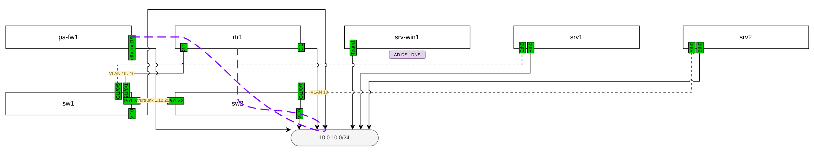
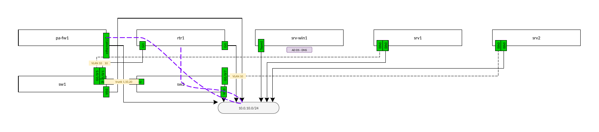
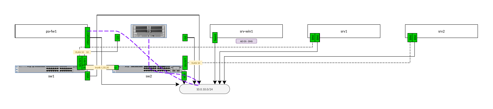

# Visio output

Created 2026-10-31 · Status: implemented, checked by opening the files in LibreOffice; check in Microsoft Visio pending

## Requirement

The project requirements were updated to emit Microsoft Visio files in
addition to draw.io. Every run now writes `output/topology.vsdx` next to
`output/topology.drawio`, and the playbook publishes both.

## Approach: convert the finished draw.io diagram

There were two ways to add a second format:

| Option | For | Against |
| --- | --- | --- |
| A second renderer, drawing the topology into Visio directly | Could use Visio-native features (connectors glued to shapes, masters) | Every feature (IPsec, VLANs, zones, roles, later VRFs) would have to draw itself twice, and the two outputs would drift apart |
| **Convert the finished draw.io XML** (chosen) | One drawing path. Features need no Visio code. The two files always show the same thing | Limited to what draw.io drew, translated shape by shape |

`scripts/vsdx.py` takes the `mxfile` tree after `renderer.py` and every
feature have finished, and writes a `.vsdx`. `main.py` calls it after
writing `topology.drawio`.

A `.vsdx` file is an Open Packaging Conventions zip of XML parts, so
`zipfile`, `zlib` and `xml.etree` are enough. No library and no Visio
install is needed.

## Mapping

| draw.io | Visio |
| --- | --- |
| `<diagram>` page, compressed or not | Page with the same name (duplicates get ` (2)`), sized to its drawing plus a 0.5 in margin |
| Layer cell (child of the root cell) | Row in the page's `Layer` section: same name, `Visible` from `visible="0"`, `Lock` from `locked=1`. The base layer is `Background` |
| Vertex | 2-D shape: `PinX`/`PinY` at the centre, `Width`/`Height`, `Angle` from `rotation`, `FillForegnd` + `FillPattern`, `LineColor` + `LinePattern` (2 for dashed), `LineWeight` |
| `rounded=1` | Four `ArcTo` rows in the geometry, radius `arcSize`% of the shorter side (the `Rounding` cell isn't used, because LibreOffice ignores it) |
| `ellipse` | `Ellipse` geometry row |
| `text` style (labels, badges) | No fill or outline unless the style has one; `labelBackgroundColor` becomes the fill, and `labelBorderColor` or `strokeColor` the outline |
| Label text | Plain text: HTML tags removed, ` ` and block elements become line breaks, entities decoded. `Character` row for colour, bold/italic/underline and size; `Paragraph` row for alignment |
| Icon (`image=data:image/png` or an SVG that only wraps one PNG) | `Foreign` shape with the PNG in `visio/media/`, letterboxed to the picture's aspect ratio. `verticalLabelPosition=bottom` puts the text block below the picture. Each distinct picture is stored once |
| Other image | Plain box with the label |
| Edge | 2-D shape whose geometry is a polyline through the exit point (`exitX`/`exitY` on the source), the waypoints and the entry point. Without exit/entry constraints, the end is clipped to the shape's border toward the next point. `curved=1` is sampled into a smooth polyline using draw.io's own curve (quadratic segments through the waypoint midpoints) |
| `endArrow` / `startArrow` | `EndArrow` / `BeginArrow`: draw.io's default `classic` → 5, `block` → 4, `open` → 1, `oval` → 10, `diamond` → 22, `none` → 0 |
| Child of an edge (interface labels, status dots) | Shape at fraction `(x + 1) / 2` along the line, plus the offset. A zero-size label is sized from its text |
| `tooltip` | `Comment` cell (Visio's ScreenTip) |
| `link="data:page/id,..."` | `Hyperlink` row with `SubAddress` = the target page's name |
| `link="data:action/json,..."` | The first `open` action's page, as above. Highlighting has no Visio equivalent |
| `link="https://..."` | `Hyperlink` row with that `Address` |
| Other `<object>` attributes, `tags` | `Property` (Shape Data) rows, row names sanitised |

Coordinates: 96 draw.io units are one inch, and the y axis is flipped
because Visio's points up.

Edges are 2-D shapes rather than 1-D connectors. A 1-D shape's geometry is
recalculated by Visio from its begin and end points, which would lose the
routed waypoints. Gluing lines to shapes (Visio's `Connects`) is left out
for the same reason: a glued connector reroutes itself when opened.

## Checking it

Microsoft Visio isn't available in this environment. LibreOffice reads
`.vsdx` with its own independent importer, so each sample was converted to
PDF with `soffice --headless --convert-to pdf` and compared with draw.io's
own viewer rendering the same diagram:

| draw.io (viewer) | Visio file (LibreOffice) |
| --- | --- |
|  |  |

With device icons from `docs/Prod_Library.xml` (the two Catalyst switches
are SVG-wrapped PNGs, the ASR1004 a plain PNG):

The comparison found and fixed: missing fills (`FillPattern` must be set),
rounded corners (LibreOffice ignores `Rounding`, so arcs are drawn), the
arrowhead index for draw.io's default arrow, and draw.io's default font
size (12 px, not 11). The VRF mockup's six pages, 383 shapes, 74 page links
and tooltips also convert and open.

The first samples opened in LibreOffice and draw.io but not in Visio
("some parts are missing or invalid"). LibreOffice and draw.io read
leniently, Visio checks the file against its schema. Two things broke it:
a shape's tooltip cell was written after its text sections, while the
schema requires every `Cell` before every `Section`, then `Text`, then
`ForeignData`; and the package had no `visio/windows.xml`, which every
Visio-saved file has. Both are fixed, and `tests/test_vsdx.py` now checks
those structural rules on every kind of shape the writer makes and on a
full `main.py` run.

`tests/test_vsdx.py` checks the package structure (every relationship
resolves, every part has a content type), positions and the y flip, routed
points, labels on lines, arrows, curves, layers, tooltips, page and web
links, Shape Data, icons and their de-duplication, compressed pages, and
`main.py`'s handling. If `soffice` is installed it also converts a file and
checks every page came out.

## Failure handling

If the conversion raises, `main.py` still writes `topology.drawio` and
`template.drawio`, deletes any older `topology.vsdx` so a stale file is
never published, prints the error and exits with status 3. The playbook
accepts status 3 for the build, publishes the draw.io file, skips the
Visio copy, and fails the job in its last play, after the read-only audit.
`--no-vsdx` or `config.WRITE_VSDX = False` turns the Visio copy off.

## Open points

- **Check in Visio.** Open a production `topology.vsdx` in Visio and check
  layers (Layer Properties), ScreenTips, Ctrl+click page links, Shape Data,
  icons and the arrowheads.
- **Editing in Visio isn't read back.** `template.drawio` stays the source
  of node positions. If people want to arrange the diagram in Visio, reading
  positions back from the `.vsdx` would be a separate change.
- **Visio stencils.** Icons are the draw.io library's pictures. If there is
  a Visio stencil the team prefers (Cisco's official one, say), nodes could
  use its masters instead.
- **HTML tables.** The VRF design draws each routing table as one HTML-table
  shape in draw.io. The converter would flatten that to text, so the VRF
  work will need to give Visio one shape per row (or per cell) when it gets
  there.
